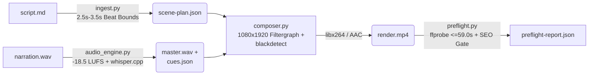

# shorts-render-pipeline

A deterministic vertical video (`1080×1920`) build and verification pipeline in Python. Parses Markdown scripts with beat pacing tags, masters narration to broadcast loudness (`-18.5 LUFS`), aligns word-level timestamps via native C++ `whisper.cpp`, compiles FFmpeg filtergraphs, and enforces pre-flight stream and SEO release gates.

## Pipeline Architecture



## Quick Start (15-Second Offline Demo)

Requires Python 3.10+ and FFmpeg. No external model weights or proprietary assets required:

```bash
python3 -m venv .venv && source .venv/bin/activate
pip install -e ".[dev]"
pytest -v
python3 -m shorts_engine.cli --demo --out-dir build/demo_15s
```

Running `--demo` generates 4 synthetic `1080×1920` panels and a 12-second audio track via FFmpeg `lavfi`, masters the audio to `-18.5 LUFS`, renders `build/demo_15s/render.mp4`, probes the output stream via `ffprobe`, and verifies pre-flight metrics:

```json
{
  "ok": true,
  "beats_count": 4,
  "word_cues_count": 4,
  "resolution": "1080x1920",
  "duration_sec": 12.0,
  "trailing_black_cut_sec": null,
  "errors": []
}
```

## Module Contracts

| Stage | Module | Verification & Guarantees |
|---|---|---|
| **1. Ingest** | `shorts_engine.ingest` | Parses `[beat id=... hold=... action=... asset=...]` tags. Rejects beats outside the `2.5s–3.5s` comic hold window or timelines exceeding `59.0s`. |
| **2. Audio** | `shorts_engine.audio_engine` | Masters narration via FFmpeg `loudnorm=I=-18.5:TP=-1.5:LRA=11.0`, downmixes a temporary 16kHz mono PCM copy for `whisper-cli -ml 1 -sow -oj`, and emits normalized word cues. |
| **3. Compose** | `shorts_engine.composer` | Generates aspect-safe `1080×1920` scale/pad + micro-action filtergraphs and scans output with `blackdetect` to catch trailing black frames without cutting mid-scene fades. |
| **4. Pre-Flight** | `shorts_engine.preflight` | Verifies `1080×1920` dimensions and `<=59.0s` runtime via `ffprobe`, enforces keyword placement (first 40 chars of title, 150 chars of description), blocks engagement-bait hashtags (`#fyp`, `#viral`), and rejects tracking query parameters (`utm_*`, `si`). |

## Running with Local whisper.cpp

To run live C++ word alignment on your own audio instead of the demo fixture, point the environment variables at your local `whisper.cpp` binary and model:

```bash
export WHISPER_CPP_BIN="/path/to/whisper.cpp/build/bin/whisper-cli"
export WHISPER_MODEL_PATH="/path/to/ggml-large-v3-turbo.bin"
python3 -m shorts_engine.cli --project-dir /path/to/project --out-dir build/prod
```

## Verification

Developed with AI coding agents and verified through unit tests (`pytest`), strict static type-checking (`mypy --strict`), linting (`ruff`), and end-to-end FFmpeg rendering in GitHub Actions CI.

## License

MIT License - Copyright (c) 2026 Kh. Shoaib Mahmud.
